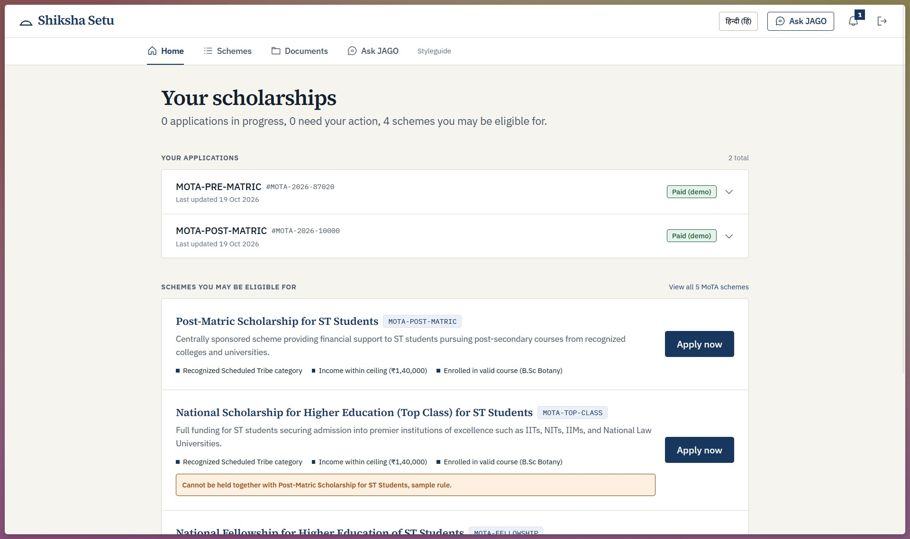
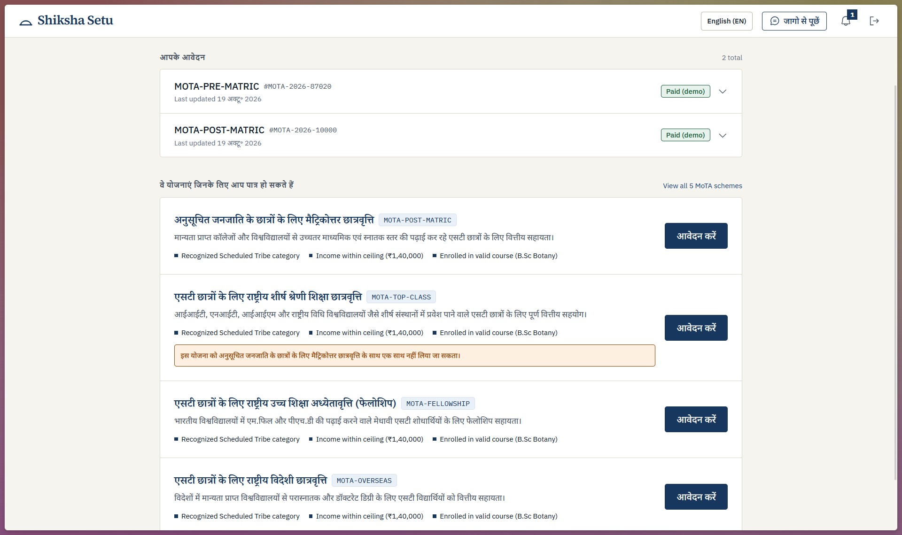
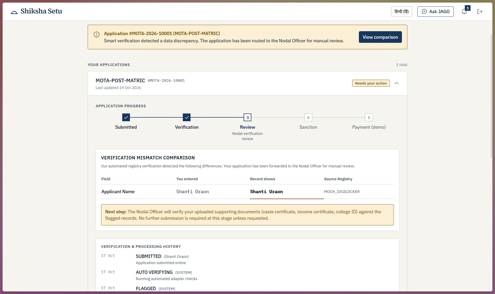
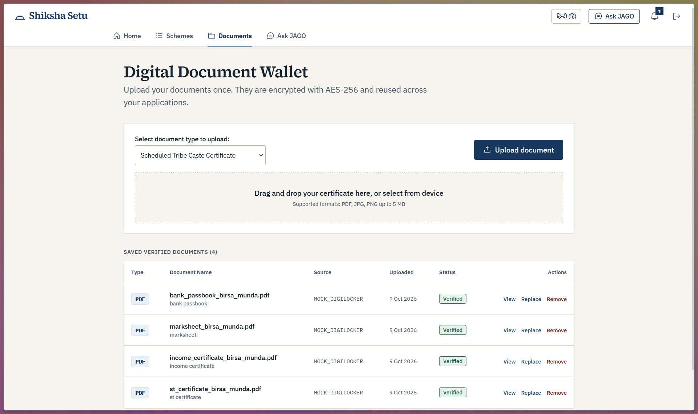
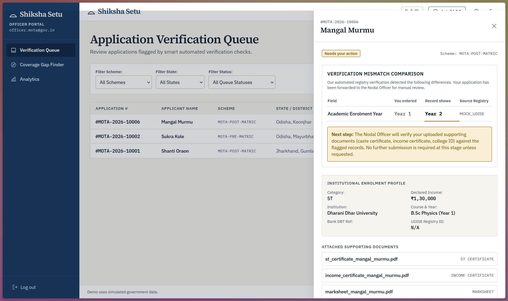
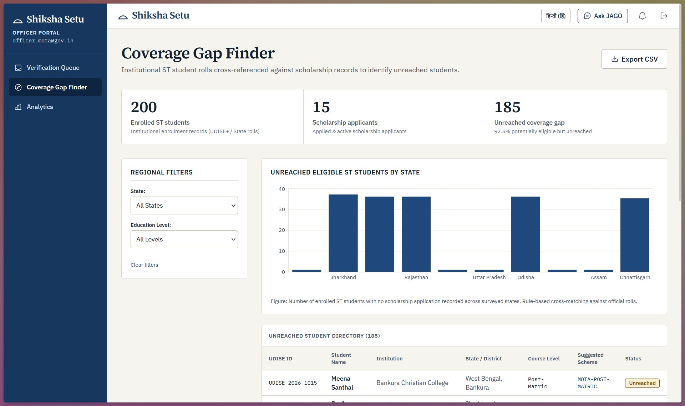
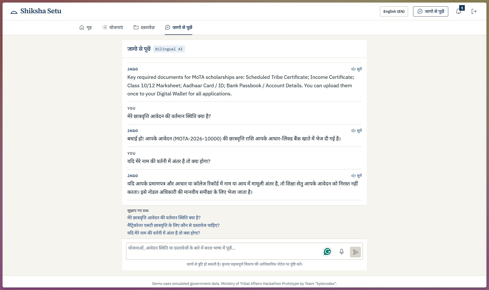
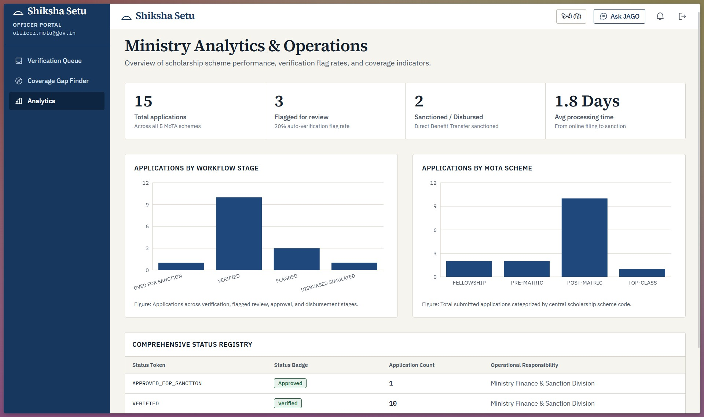

# Shiksha Setu (शिक्षा सेतु)

> **A Unified Digital Bridge for Scheduled Tribe (ST) Students to Discover, Apply for, and Track Ministry of Tribal Affairs (MoTA) Scholarships.**
>
> **Submission:** Hackathon Team "bytecodex" | **Theme:** Education & Skill Development | **License:** MIT

---

## Quick Navigation & Documentation Links

- 🖼️ **[UI Screenshots Gallery](./docs/screenshots/):** High-resolution visual captures of the Student PWA (English & Hindi), Officer Queue, JAGO AI, and Coverage Gap Finder.
- 📘 **[Technical Design Document](./docs/TECHNICAL_DESIGN.md):** Full system architecture, Mermaid diagrams, DPDP consent model, ER data schemas, security guardrails, and scope & limitations.
- 🔌 **[REST API Specification](./docs/API.md):** Comprehensive reference for all 20+ REST endpoints, request/response JSON schemas, and error codes.
- ⏱️ **[5-Minute Demo Script](./docs/DEMO.md):** Step-by-step evaluator walkthrough script for live presentation and testing.

---

## UI Preview & Screenshots

| Student Dashboard (English) | Student Dashboard (हिन्दी) |
|---|---|
|  |  |

| Smart Verification (Non-Destructive Flagging) | Document Wallet (AES-256-GCM Encrypted) |
|---|---|
|  |  |

| Nodal Officer Review & Decision Drawer | Coverage Gap Finder (Reconciliation) |
|---|---|
|  |  |

| JAGO Multilingual Voice Assistant | Officer Analytics Overview |
|---|---|
|  |  |

> 📁 *All 13 high-resolution screen captures are available in the **[`docs/screenshots/`](./docs/screenshots/)** directory.*

---

## 1. Problem Statement & Solution

Tribal (Scheduled Tribe, "ST") students across India face substantial systemic hurdles accessing central scholarships:
1. **Portal Fragmentation:** 5 MoTA scholarship schemes are spread across 3 disconnected portals (National Scholarship Portal, Single Fellowship Management Portal, and National Overseas Scholarship portal).
2. **Redundant Documentation:** Students submit identical certificates repeatedly, leading to verification backlogs, delays, and lost opportunities.
3. **Language & Literacy Barriers:** Lack of plain-language multilingual guidance and voice interfaces leaves eligible first-generation students unreached.
4. **Coverage Gaps:** Institutional enrolment records (UDISE+/APAAR) and scholarship rolls are never reconciled, leaving eligible students unreached.
5. **Silent Rejections:** Minor spelling variations between certificates and Aadhaar records often result in silent rejections without recourse.

### The Shiksha Setu Solution
**Shiksha Setu** delivers an integrated, accessible Progressive Web App (PWA) with a Node.js Express backend and embedded zero-config database:
- **Unified Scholarship Dashboard:** One login for all 5 MoTA schemes, displaying eligible schemes, conflict warnings, and real-time 5-stage progress tracking.
- **Digital Document Wallet:** Upload verified documents once (caste certificate, income certificate, marksheet, bank passbook), encrypted with **AES-256-GCM**, and reused across applications.
- **Smart Verification Layer:** Pre-submission verification against mock government databases (DigiLocker, UDISE+, APAAR, OTR, e-District, PFMS). **Mismatches are flagged for empathetic human review and never silently rejected.**
- **JAGO AI Assistant:** Multilingual (English + Hindi) conversational guide with speech-to-text, read-aloud, prompt injection defense, and offline deterministic fallback.
- **Coverage Gap Finder (Ministry / Officer Portal):** Cross-matches institutional enrolment data with scholarship applications to identify and export unreached ST youth.
- **Nodal Officer Portal:** Dense review queue, split comparison table, mandatory decision remarks with automated alternative recommendations, and CSV export.
- **Offline-Ready PWA:** Installable, service worker caching, and IndexedDB local dashboard storage.

---

## 2. MoTA Scholarship Schemes Covered

Shiksha Setu consolidates all 5 central scholarship schemes administered by the Ministry of Tribal Affairs:

| # | Scheme Name | Level | Host Portal (Current) |
|---|---|---|---|
| 1 | **Pre-Matric Scholarship for ST Students** | Class IX & X | National Scholarship Portal (NSP) |
| 2 | **Post-Matric Scholarship for ST Students** | Post-Secondary & College | National Scholarship Portal (NSP) |
| 3 | **National Fellowship and Scholarship for Higher Education of ST Students** | M.Phil / Ph.D. & Top Institutes | Single Fellowship Management Portal (SFMP) |
| 4 | **National Overseas Scholarship for ST Candidates** | Master's & Ph.D. Abroad | National Overseas Portal (NOS) |
| 5 | **Top Class Education for ST Students** | Premier Institutes (IIT, IIM, NIT, AIIMS) | National Scholarship Portal (NSP) |

---

## 3. Key Innovations & Differentiators

1. **Non-Destructive Smart Verification (Zero Silent Rejections):**  
   Minor spelling differences (e.g., *"Shanti Oraon"* vs DigiLocker record *"Shanti Uraon"*) or minor income certificate variances are never automatically rejected. They are marked `FLAGGED`, generate a side-by-side mismatch comparison table, and are routed to a human Nodal Officer for empathetic review.
2. **Constructive Rejection with Alternative Recommendations:**  
   If an application cannot be approved, the officer is mandated to enter written justification remarks, and the platform automatically computes and displays alternative eligible schemes for the student.
3. **Voice-Enabled Multilingual JAGO AI Assistant:**  
   First-generation tribal learners can speak or type in English or Hindi. Includes speech-to-text, read-aloud audio synthesis, prompt-injection defense against jailbreaks, and a deterministic rule-based offline fallback when cloud LLMs are disconnected.
4. **AES-256-GCM Encrypted Document Vault:**  
   All certificates are stored encrypted at rest using AES-256-GCM with authenticated tags (`[16B IV][16B AuthTag][Ciphertext]`), decrypted in memory only when requested by the authenticated owner.
5. **Coverage Gap Finder:**  
   District and state officers can reconcile institutional enrolment figures (`EnrollmentRecord`) against scholarship application rolls in real time, visualising gaps by state and exporting unreached students to CSV for on-ground welfare drives.

---

## 4. Quick Start (Running Locally)

### Prerequisites
- **Node.js**: v18+ or v20+
- **npm**: v9+ or v10+
- *(MongoDB is completely optional; the backend automatically falls back to an embedded in-memory database if no local MongoDB instance is running)*

### 1. Install Dependencies
```bash
# Installs dependencies for monorepo workspaces (server and client)
npm install
```

### 2. Seed Database
```bash
# Populates schemes, knowledge docs, officer accounts, sample students, and enrollment records
npm run seed
```

### 3. Start Both Services (One Command)
```bash
# Launches Express backend (:5000) and React Vite PWA (:3000) concurrently
npm run dev
```

Open **`http://localhost:3000`** in your browser.

---

## 5. Judge & Evaluator Walkthrough (2-Minute Test Paths)

### Persona A: ST Student Applicant (`shanti.oraon@example.in`)
1. Log in using `shanti.oraon@example.in` / `Student@123` (or click the quick prefill button on the login screen).
2. Note the bilingual language switch (**English** / **हिन्दी**) at the top right.
3. On the Home screen, examine the **"Needs your action"** section. Click **"View comparison"** to inspect the non-destructive mismatch table highlighting differences between entered data and DigiLocker records.
4. Navigate to **Documents** to see verified encrypted certificates stored in the wallet.
5. Click **"Ask JAGO"** to query application status using voice or text in either language.

### Persona B: MoTA Nodal Officer (`officer.mota@gov.in`)
1. Log in using `officer.mota@gov.in` / `Officer@123`.
2. In the **Verification Queue**, click on Shanti Oraon's flagged application. Inspect the split drawer showing applicant details, attached certificates, and mismatch diffs.
3. Submit a review decision with mandatory officer remarks.
4. Navigate to **Coverage Gap Finder** in the sidebar to review institutional enrolment reconciliation charts and click **"Export CSV"** to download outreach lists.

---

## 6. Demo Credentials Summary

| Role | Email | Password | Scenario Highlight |
|---|---|---|---|
| **Clean ST Student** | `birsa.munda@example.in` | `Student@123` | Clean profile, verified application, simulated DBT disbursement |
| **Flagged ST Student** | `shanti.oraon@example.in` | `Student@123` | Name spelling mismatch with DigiLocker; routed to review queue |
| **Income Mismatch Student** | `sukra.kole@example.in` | `Student@123` | Income certificate discrepancy requiring nodal review |
| **Fellowship Applicant** | `anjali.marandi@example.in` | `Student@123` | Higher education fellowship application |
| **Unreached Student** | `rahul.soren@example.in` | `Student@123` | Newly enrolled student with no prior applications |
| **National Nodal Officer** | `officer.mota@gov.in` | `Officer@123` | Full verification queue, Coverage Gap Finder, Analytics |
| **State Nodal Officer (JH)**| `officer.jharkhand@gov.in`| `Officer@123` | State-level verification queue and reporting |

*(All 25 seeded student accounts use default demo password: `Student@123`)*

---

## 7. Repository Structure

```
shiksha-setu/
├── client/                     # Frontend Progressive Web App
│   ├── public/                 # PWA icons, manifest, and static assets
│   ├── src/
│   │   ├── components/         # TopBar, StudentNav, OfficerSidebar, OfflineBanner
│   │   ├── context/            # AuthContext (stateless JWT session state)
│   │   ├── i18n/               # Complete English & Hindi dictionary mappings
│   │   ├── pages/              # StudentHome, SchemesDirectory, SchemeApply, Wallet,
│   │   │                       # OfficerQueue, CoverageGapFinder, OfficerAnalytics, Login
│   │   ├── services/           # api.js (Axios/fetch client)
│   │   ├── ui/                 # Accessible UI components (Badge, Button, Stepper, JagoPanel)
│   │   ├── App.jsx             # Role-based route definitions and layouts
│   │   └── main.jsx            # Application entrypoint
│   └── vite.config.js          # Vite configuration with PWA plugin & proxy
├── server/                     # Backend Express REST API
│   ├── seed/                   # Database seed scripts and sample knowledge/scheme JSON
│   ├── src/
│   │   ├── adapters/           # Mock government registries (DigiLocker, UDISE+, APAAR, PFMS)
│   │   ├── config/             # Environment parsing and MongoDB / In-memory DB setup
│   │   ├── controllers/        # Express route controllers
│   │   ├── middleware/         # JWT authentication, RBAC, error handling, file upload
│   │   ├── models/             # Mongoose schemas (User, Application, Scheme, AuditLog, etc.)
│   │   ├── routes/             # REST route endpoints
│   │   ├── services/           # Business logic (eligibility, verification, audit, JAGO RAG)
│   │   └── utils/              # AES-256-GCM encryption & decryption utility
│   ├── uploads/                # Encrypted document storage directory
│   └── server.js               # Express application entrypoint
├── docs/                       # Technical Documentation
│   ├── TECHNICAL_DESIGN.md     # Architecture, data schemas, security, and scope & limitations
│   ├── API.md                  # Complete REST API endpoint contracts
│   └── DEMO.md                 # 5-minute evaluator demonstration script
└── package.json                # Monorepo workspaces configuration
```

---

## 8. Environment Variables

All configuration settings are defined in `.env` (or environment variables) with sensible zero-configuration defaults:

| Variable | Required | Default | Description |
|---|---|---|---|
| `PORT` | No | `5000` | Port for the Express REST API backend |
| `NODE_ENV` | No | `development` | Runtime environment (`development`, `production`) |
| `MONGODB_URI` | No | `mongodb://localhost:27017/shiksha_setu` | MongoDB connection URI. Automatically falls back to in-memory database if unavailable |
| `USE_MEMORY_DB` | No | `true` | When `true`, uses embedded in-memory MongoDB for zero-install demo runs |
| `JWT_SECRET` | Yes | Provided in `.env.example` | Secret string used for signing and verifying JSON Web Tokens (min 32 chars) |
| `JWT_EXPIRES_IN` | No | `7d` | Token expiry duration (e.g., `7d`, `24h`) |
| `DOC_ENCRYPTION_KEY` | Yes | Provided in `.env.example` | 32-byte hexadecimal key (64 hex characters) for AES-256-GCM document encryption |
| `CLIENT_URL` | No | `http://localhost:3000` | Allowed CORS origin for the React frontend client |
| `LLM_PROVIDER` | No | `none` | AI provider for JAGO assistant (`gemini`, `openai`, or `none` for deterministic rule-based fallback) |
| `GEMINI_API_KEY` | Conditional | - | API key for Google Gemini (required only if `LLM_PROVIDER=gemini`) |
| `OPENAI_API_KEY` | Conditional | - | API key for OpenAI (required only if `LLM_PROVIDER=openai`) |

---

## 9. Disclosures & Ethics

### Simulated Government Data Disclosure
> **IMPORTANT:** This prototype utilizes **simulated sample government data** for demonstration purposes. Adapters for DigiLocker, UDISE+, APAAR, One-Time Registration (OTR), State e-District, and PFMS/DBT are mocked behind clean service interfaces (`server/src/adapters/`). No real citizen personal data is stored, processed, or exposed.

### AI Usage Disclosure
> AI tools (including Claude, ChatGPT, and Gemini) were utilized during the design and development of this prototype for code scaffolding, documentation structure, and drafting bilingual copy. All business logic, security constraints, and accessibility requirements were reviewed, implemented, and validated by the team.
