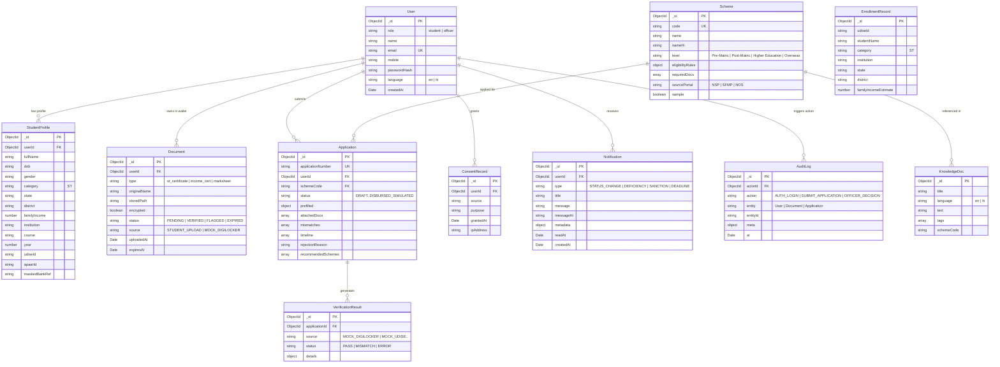

# Shiksha Setu: Technical Design Document

This document provides a comprehensive technical architecture, flowchart, data model, and security specification for **Shiksha Setu**, a unified scholarship platform for the Ministry of Tribal Affairs (MoTA).

For the complete list of REST API endpoints, request/response contracts, and status codes, refer to the [API Endpoint Documentation](./API.md).

---

## 1. System Architecture

The following diagram illustrates the high-level architecture of Shiksha Setu, connecting the student Progressive Web App (PWA) and the Nodal Officer portal to the Express REST API, notification service, rule-based coverage gap analyzer, encryption vault, RAG knowledge engine, and simulated government registries.

```mermaid
graph TD
    subgraph Client ["Client Tier (PWA)"]
        SPA["React 18 PWA (Student and Officer views)"]
        SW["Service Worker (vite-plugin-pwa)"]
        IDB[("IndexedDB (idb Cache)")]
        Speech["Web Speech API (STT / TTS)"]
    end

    subgraph API ["Application Tier (Node.js 20 / Express)"]
        AuthMid["JWT Auth & RBAC Middleware"]
        AuditSvc["Audit Logging Service"]
        ConsentSvc["Consent Verification Service"]
        CryptoUtil["AES-256-GCM Encryption Vault"]
        EligEngine["Eligibility & Conflict Engine"]
        AppSvc["Smart Verification & Application Pipeline"]
        JagoSvc["JAGO RAG & Fallback AI Engine"]
        GapSvc["Coverage Gap Analyzer (rule-based)"]
        NotifySvc["Notification Service (in-app; SMS/Email/WhatsApp stubs)"]
    end

    subgraph Storage ["Data Tier"]
        Mongo[("MongoDB / In-Memory Server")]
        Uploads[("Encrypted Document Storage (/uploads)")]
    end

    subgraph Adapters ["Simulated Government Registries (Adapters)"]
        DL["DigiLocker Adapter (Identity & ST Caste)"]
        UDISE["UDISE+ Adapter (School/College Enrolment)"]
        APAAR["APAAR Adapter (ABC Academic Credits)"]
        OTR["OTR Adapter (Central One-Time Reg)"]
        EDIST["State e-District (Revenue Income Reg)"]
        PFMS["Bank & PFMS DBT Gateway (Simulated)"]
    end

    SPA <--> SW
    SW <--> IDB
    SPA <--> Speech
    SPA <-->|"REST API (JSON / Bearer JWT)"| AuthMid

    AuthMid --> ConsentSvc
    AuthMid --> AuditSvc
    AuthMid --> EligEngine
    AuthMid --> AppSvc
    AuthMid --> JagoSvc
    AuthMid --> GapSvc

    GapSvc --> Mongo
    AppSvc --> NotifySvc
    NotifySvc --> Mongo

    CryptoUtil <--> Uploads
    AppSvc --> CryptoUtil
    AppSvc --> Mongo
    JagoSvc --> Mongo
    AuditSvc --> Mongo

    AppSvc --> DL
    AppSvc --> UDISE
    AppSvc --> APAAR
    AppSvc --> OTR
    AppSvc --> EDIST
    AppSvc --> PFMS
```

---

## 2. End-to-End Application Flow

The lifecycle of a scholarship application through smart auto-verification, non-destructive mismatch handling, officer review, and simulated DBT disbursement is modeled below:

---

## 3. Entity-Relationship Data Model

The database schemas implemented with Mongoose are structured as follows:

---

## 4. Technology Stack

| Tier | Technologies / Libraries | Purpose |
|---|---|---|
| **Frontend** | React 18, Vite 5, Tailwind CSS 3, React Router 6, react-i18next, `@phosphor-icons/react`, Recharts | Responsive, accessible bilingual PWA with student portal, nodal officer queue, and analytics |
| **Backend API** | Node.js 20, Express 4, Multer, Zod, Helmet, Morgan, Express Rate Limit | RESTful microservice API, authentication, file upload processing, validation, and security headers |
| **Database** | MongoDB 8 with Mongoose ODM (with embedded `mongodb-memory-server` fallback) | Schematized data storage with automated in-memory fallback for zero-install demo runs |
| **Security & Crypto** | AES-256-GCM (`crypto`), JSON Web Tokens (`jsonwebtoken`), `bcryptjs` | Authenticated document encryption at rest, stateless session authentication, salted password hashing |
| **PWA & Offline** | `vite-plugin-pwa`, Service Workers, Web App Manifest | Installable application shell, static asset precaching, and network status monitoring |
| **AI Assistant** | JAGO RAG Engine, Google Gemini API / OpenAI API (optional), Web Speech API | Multilingual conversational voice & text guidance with deterministic rule-based offline fallback |
| **DevOps & Packaging** | Docker, Docker Compose, Concurrently | Monorepo orchestration and containerized runtime definitions |

---

## 5. Security & Privacy Architecture

1. **Role-Based Access Control (RBAC):**
   - Routes are strictly segregated by role (`student`, `officer`).
   - A student accessing any `/api/officer/*` endpoint receives `403 FORBIDDEN`.
   - **Officer Permissions Guardrail:** Officers cannot modify applicant financial data or profile details directly; they can only approve or reject applications with mandatory written remarks.
2. **Encrypted Digital Document Storage:**
   - Physical document payloads are encrypted with **AES-256-GCM** prior to writing to the filesystem.
   - Files are stored with authenticated tags packed in the format `[16B IV][16B AuthTag][Ciphertext]`. AES-GCM standard often defaults to a 12-byte IV; this implementation utilizes a 16-byte random IV (`crypto.randomBytes(16)`) combined with a 16-byte GCM authentication tag for enhanced per-file entropy. Decryption occurs strictly in-memory when requested by the authenticated owner.
3. **Citizen Consent (aligned with DPDP Act principles: consent and purpose limitation):**
   - The platform enforces that no external adapter query (DigiLocker, UDISE+, e-District) is performed without an active `ConsentRecord` timestamped to the student's authenticated session, establishing purpose limitation and explicit user consent before external verification.
4. **Audit Trail Logging:**
   - Every registration, authentication, document upload/deletion, application submission, and officer decision is recorded into an append-only `AuditLog` collection.
5. **Prompt Injection & LLM Guardrails:**
   - User inputs to the JAGO AI assistant are filtered using regex-based security sanitization (`sanitizeInput()`) that detects and blocks instruction overriding, privilege escalation (`you are now admin`), database drops, and lateral user data leaks before calling LLMs.
   - Authorized tools (`getMyApplicationStatus`, `checkMyEligibility`) only query data belonging to the authenticated `req.user._id`, preventing lateral cross-tenant information exposure.

---

## 6. JAGO AI Assistant & RAG Implementation

The JAGO assistant is designed as a hybrid Retrieval-Augmented Generation (RAG) assistant tailored for first-generation tribal learners. When a user sends a query (via voice or text in English or Hindi):
1. **Security Sanitization:** The query passes through the prompt injection detector. If malicious patterns are detected, it is immediately rejected.
2. **Authorized Tool Calling:** If the student asks about personal status or scheme eligibility (e.g., *"What is the status of my application?"*), JAGO executes authenticated backend tools scoped strictly to `req.user._id`.
3. **Knowledge Retrieval:** For informational queries regarding guidelines, document requirements, or grievance processes, JAGO searches the bilingual `KnowledgeDoc` collection using keyword and tag matching.
4. **Deterministic Rule-Based Fallback:** If external cloud LLM providers (Gemini or OpenAI) are unconfigured (`LLM_PROVIDER=none`) or unavailable offline, JAGO automatically falls back to an internal deterministic response engine that extracts answers directly from the matched knowledge documents and tool results in the student's selected language.

---

## 7. Coverage Gap Finder & Machine Learning Roadmap

The **Coverage Gap Finder** is implemented as a **deterministic, rule-based reconciliation service** (`server/src/controllers/officerController.js`). It cross-matches institutional enrolment records (`EnrollmentRecord`, populated from UDISE+ and state databases) against submitted scholarship applications (`Application`), filtering for eligible ST students who have not yet applied.

* **Current Implementation (Rule-Based):** Applies deterministic matching criteria (matching state, district, ST category, and income threshold) to surface unreached students for export.
* **Future Machine Learning Roadmap:** Predictive models (using frameworks like TensorFlow / PyTorch) to forecast institutional dropout risks, identify high-attrition geographical clusters, and recommend proactive community outreach timing are planned as future extensions and marked as roadmap items.

---

## 8. Scope & Limitations

To ensure transparency and integrity during hackathon evaluation:
- **Simulated Government Registries:** Adapters for DigiLocker, UDISE+, APAAR, OTR, State e-District, and PFMS are simulated mock services (`server/src/adapters/`). They simulate network latency and realistic mismatches (e.g., spelling differences, income variance) without connecting to live government production infrastructure.
- **Simulated Sanctions & DBT:** The Direct Benefit Transfer (DBT) and sanction approval flows simulate PFMS transaction IDs and account credits for demonstration purposes.
- **Synthetic Data:** All student names, Aadhaar tokens, certificates, and enrollment figures are synthetic mock records created for testing. No real citizen Personally Identifiable Information (PII) is processed.
- **Illustrative Eligibility Rules:** Scheme eligibility criteria are modeled based on published Ministry of Tribal Affairs guidelines for demonstration and testing purposes.
