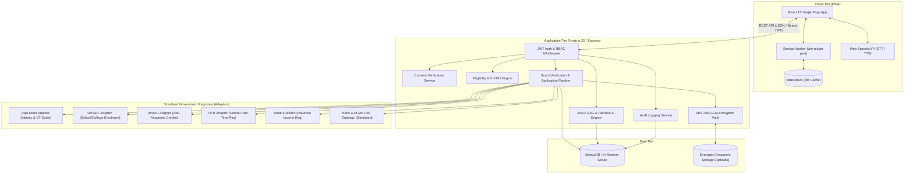
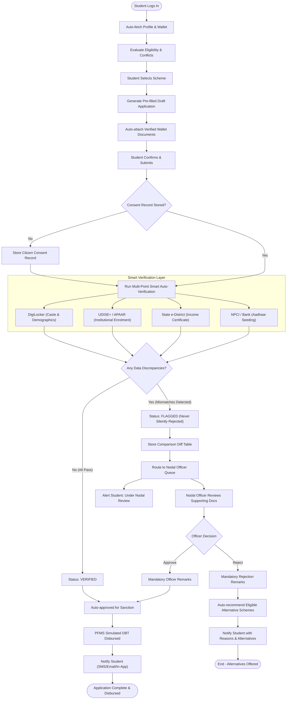
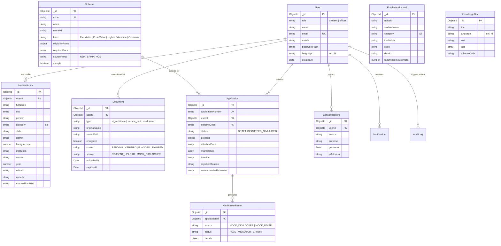

# Shiksha Setu: Technical Design Document

This document provides a comprehensive technical architecture, flowchart, data model, and security specification for **Shiksha Setu**, a unified scholarship platform for the Ministry of Tribal Affairs (MoTA).

---

## 1. System Architecture

The following diagram illustrates the high-level architecture of Shiksha Setu, connecting the student Progressive Web App (PWA) and the Nodal Officer portal to the Express REST API, encryption vault, RAG knowledge engine, and simulated government registries.

---

## 2. End-to-End Application Flow

The lifecycle of a scholarship application through smart auto-verification, non-destructive mismatch handling, and simulated DBT disbursement is modeled below:

---

## 3. Entity-Relationship Data Model

The database schemas implemented with Mongoose are structured as follows:

---

## 4. Security & Privacy Architecture

1. **Role-Based Access Control (RBAC):**
   - Routes are strictly segregated by role (`student`, `officer`).
   - A student accessing any `/api/officer/*` endpoint receives `403 FORBIDDEN`.
   - Officers cannot modify applicant financial data directly; they can only approve or reject with written remarks.
2. **Encrypted Digital Document Storage:**
   - Physical document payloads are encrypted with **AES-256-GCM** prior to writing to the filesystem.
   - Files are stored with authenticated tags (`[16B IV][16B AuthTag][Ciphertext]`). Decryption occurs only in memory when requested by the authenticated owner.
3. **Mandatory Citizen Consent (DPDP Act Compliance):**
   - The platform strictly enforces that no external adapter query (DigiLocker, UDISE+, e-District) is performed without an active `ConsentRecord` timestamped to the user.
4. **Audit Trail Logging:**
   - Every registration, authentication, document upload/deletion, application submission, and officer decision is recorded into an append-only `AuditLog` collection.
5. **Prompt Injection & LLM Guardrails:**
   - User inputs to the JAGO AI assistant are filtered for role impersonation, instruction override, and database manipulation attempts.
   - Authorized tools (`getMyApplicationStatus`, `checkMyEligibility`) only query data belonging to the authenticated `req.user._id`, preventing lateral cross-tenant information exposure.
